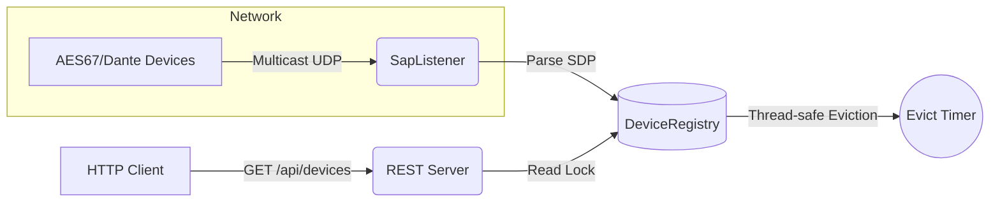

# AES67 / Dante SAP Discovery Daemon


A high-performance, thread-safe C++20 microservice that listens for SAP (Session Announcement Protocol) packets on Multicast UDP to discover AES67/Dante audio streams on a local network. It automatically evicts stale devices and exposes a real-time REST API for monitoring.

**Why this matters:** mapping AES67/Dante devices in large corporate L3 networks usually requires paid vendor tools (Dante Controller, Q-SYS Designer). This daemon provides a free, lightweight, programmable topology map — ideal for CI/CD provisioning, monitoring stacks (Prometheus/Grafana via the JSON API) and automated AV system orchestration.

## Architecture



## REST API

| Endpoint | Description |
|---|---|
| `GET /health` | Liveness probe → `{"status":"ok"}` |
| `GET /api/devices` | Active devices (seen within the TTL window) |

Example response:

```json
[
  {
    "name": "Virtual Q-SYS Core",
    "ip": "172.30.36.69",
    "stream_address": "239.69.10.20",
    "stream_port": 5004,
    "stream_type": "audio"
  }
]
```

## Configuration

All settings are optional environment variables (defaults in parentheses):

| Variable | Default | Description |
|---|---|---|
| `AES67_SAP_GROUP` | `239.255.255.255` | SAP multicast group |
| `AES67_SAP_PORT` | `9875` | SAP UDP port |
| `AES67_HTTP_HOST` | `0.0.0.0` | REST API bind address |
| `AES67_HTTP_PORT` | `8080` | REST API port |
| `AES67_DEVICE_TIMEOUT` | `60` | Seconds without an announce before a device is evicted |
| `AES67_EVICT_INTERVAL` | `10` | Seconds between eviction sweeps |

SAP **delete** packets (RFC 2974 "T" flag) remove a device immediately,
without waiting for the timeout.

## Testing

```bash
ctest --test-dir build --output-on-failure -V
```

* **Unit tests** (`tests/test_*.cpp`, GoogleTest) — SDP parser edge cases and
  registry TTL behaviour.
* **Functional tests** (`tests/functional/`) — spawn the real daemon on
  ephemeral ports, send actual SAP packets via `sap_sender.py`, and assert on
  the REST API: announce → visible, second sender → both visible, SAP delete
  → removed, silence → evicted after timeout.

Quick manual smoke test with a fake sender:

```bash
./build/aes67_daemon &
python3 mock_sender.py        # sends periodic fake announces
curl -s localhost:8080/api/devices | jq
```

## License

MIT — see [LICENSE](LICENSE).

## Tech Stack
* **Language:** Modern C++20 (`std::shared_mutex`, `std::optional`, structured bindings)
* **Networking:** Boost.Asio (Asynchronous UDP Multicast)
* **API:** `cpp-httplib` (HTTP Server) and `nlohmann/json` (Serialization)
* **Optional GUI:** Qt6 Widgets (`aes67_gui`, requires `qt6-base-dev` to build)
* **Design:** Multi-threaded architecture with optimized reader-writer locks (Single Writer, Multiple Readers).

## Project structure

```
aes67-daemon/
├── src/                  # daemon sources (header-only components + main.cpp)
│   ├── main.cpp          # entry point: wires listener, registry, HTTP server
│   ├── SdpParser.hpp     # SAP/SDP payload parser (pure, unit-testable)
│   ├── DeviceRegistry.hpp# thread-safe device table with TTL eviction
│   ├── Logger.hpp        # timestamped logging
│   ├── httplib.h         # vendored cpp-httplib (single header)
│   └── gui/              # optional Qt6 GUI (aes67_gui target, needs qt6-base-dev)
├── tests/                # GoogleTest unit tests
├── .github/workflows/    # CI (build + tests)
├── CMakeLists.txt
├── vcpkg.json            # dependency manifest
└── mock_sender.py        # helper: sends fake SAP announces for smoke tests
```

Runtime logs and ad-hoc scratch files live in `logs/` and `tmp/` — both are
git-ignored and never part of the repository.

## Build Instructions

Dependencies are managed with **vcpkg** (manifest mode). Install vcpkg and point
CMake at its toolchain file:

```bash
git clone https://github.com/microsoft/vcpkg.git
./vcpkg/bootstrap-vcpkg.sh
export VCPKG_ROOT=$PWD/vcpkg

cmake -B build -S . \
  -DCMAKE_TOOLCHAIN_FILE=$VCPKG_ROOT/scripts/buildsystems/vcpkg.cmake
cmake --build build --config Release
./build/aes67_daemon
```

Alternatively, with system packages (no vcpkg):

```bash
sudo apt-get install cmake g++ libboost-system-dev nlohmann-json3-dev
cmake -B build -S . && cmake --build build
./build/aes67_daemon
```

### Qt GUI (optional)

The repository also contains an optional Qt6 desktop app (`aes67_gui`) that
visualizes discovered devices in real time. It is **not required** for the
daemon — without Qt6 installed, CMake simply skips the GUI target and builds
only `aes67_daemon` + tests.

To build the GUI you need Qt6 development packages:

```bash
# Debian/Ubuntu >= 22.04
sudo apt-get install qt6-base-dev
# Fedora: sudo dnf install qt6-qtbase-devel
# Windows/macOS: official Qt installer or vcpkg
# Ubuntu 20.04 (no qt6 in apt) — install via aqtinstall into ~/qt (no sudo needed,
# note: "sudo ~/.local/bin/aqt" breaks because sudo changes HOME to /root):
sudo apt install -y python3-pip libgl1-mesa-dev libxkbcommon-x11-0 libxcb-cursor0
pip3 install aqtinstall
~/.local/bin/aqt install-qt linux desktop 6.5.3 gcc_64 -O ~/qt
```

CMake automatically probes `/opt/qt` **and** `~/qt` for aqtinstall layouts
(`<dir>/<version>/gcc_64`), so no `CMAKE_PREFIX_PATH` is needed:

```bash
cmake -B build -S . && cmake --build build --target aes67_gui
./build/aes67_gui
```

If your Qt lives somewhere else: `cmake -B build -S . -DQT6_FALLBACK_PREFIXES=/custom/dir`
or `-DCMAKE_PREFIX_PATH=/custom/qt/6.5.3/gcc_64`.

To explicitly disable the GUI target even when Qt6 is present:
`cmake -B build -S . -DBUILD_GUI=OFF`