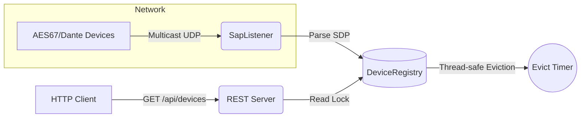

# AES67 / Dante SAP Discovery Daemon


A high-performance, thread-safe C++20 microservice that listens for SAP (Session Announcement Protocol) packets on Multicast UDP to discover AES67/Dante audio streams on a local network. It automatically evicts stale devices and exposes a real-time REST API for monitoring.

## Architecture



## Tech Stack
* **Language:** Modern C++20 (`std::shared_mutex`, `std::optional`, structured bindings)
* **Networking:** Boost.Asio (Asynchronous UDP Multicast)
* **API:** `cpp-httplib` (HTTP Server) and `nlohmann/json` (Serialization)
* **Design:** Multi-threaded architecture with optimized reader-writer locks (Single Writer, Multiple Readers).

## Build Instructions
Ensure you have CMake, a C++20 compatible compiler, Boost.System, and nlohmann-json installed.

```bash
mkdir build && cd build
cmake ..
make
./aes67_daemon
```