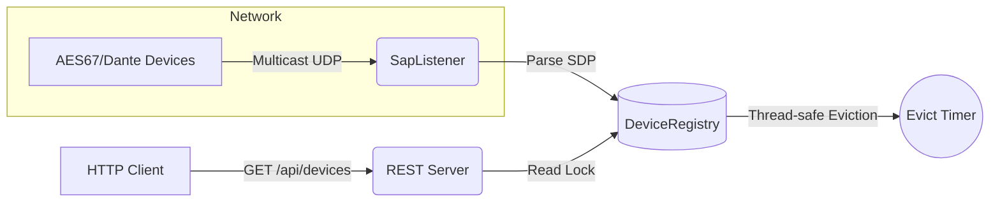

# AES67 / Dante SAP Discovery Daemon


A high-performance, thread-safe C++20 microservice that listens for SAP (Session Announcement Protocol) packets on Multicast UDP to discover AES67/Dante audio streams on a local network. It automatically evicts stale devices and exposes a real-time REST API for monitoring.

**Why this matters:** mapping AES67/Dante devices in large corporate L3 networks usually requires paid vendor tools (Dante Controller, Q-SYS Designer). This daemon provides a free, lightweight, programmable topology map — ideal for CI/CD provisioning, monitoring stacks (Prometheus/Grafana via the JSON API) and automated AV system orchestration.

## Architecture



## Tech Stack
* **Language:** Modern C++20 (`std::shared_mutex`, `std::optional`, structured bindings)
* **Networking:** Boost.Asio (Asynchronous UDP Multicast)
* **API:** `cpp-httplib` (HTTP Server) and `nlohmann/json` (Serialization)
* **Design:** Multi-threaded architecture with optimized reader-writer locks (Single Writer, Multiple Readers).

## Build Instructions

Dependencies are managed with **vcpkg** (manifest mode). Install vcpkg and point
CMake at its toolchain file:

```bash
git clone https://github.com/microsoft/vcpkg.git
./vcpkg/bootstrap-vcpkg.sh
export VCPKG_ROOT=$PWD/vcpkg

cmake -B build -S . \
  -DCMAKE_TOOLCHAIN_FILE=$VCPKG_ROOT/scripts/buildsystems/vcpkg.cmake
cmake --build build --config Release
./build/aes67_daemon
```

Alternatively, with system packages (no vcpkg):

```bash
sudo apt-get install cmake g++ libboost-system-dev nlohmann-json3-dev
cmake -B build -S . && cmake --build build
./build/aes67_daemon
```